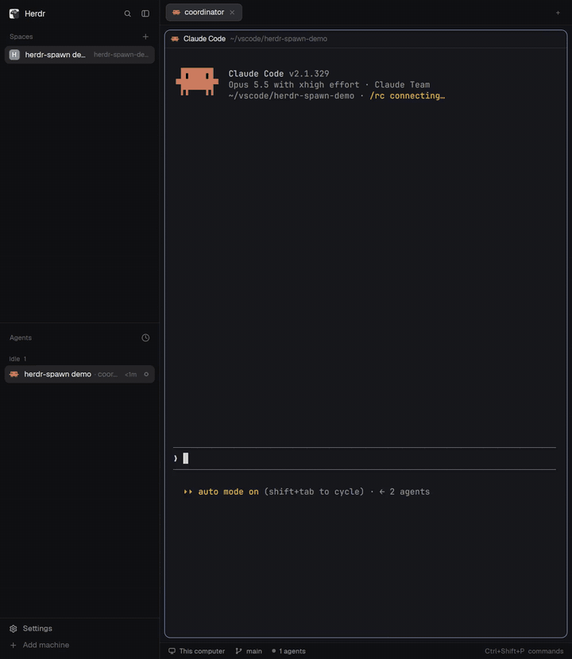

# herdr-spawn

A skill that lets a coding agent spawn another agent session (`claude`, `codex`, `opencode`, `omp` or any CLI you name) in a sibling [Herdr](https://herdr.dev) pane with an initial prompt, keep the tab an even grid, and coordinate with the child afterwards. The caller can be Claude Code, Codex, OpenCode or oh-my-pi. It ships as a Claude Code plugin and as a plain skill folder.

An Opus coordinator in the Herdr app runs two tickets as driver lanes, each in its own tab and worktree. Each lane hands the code to a Sonnet worker and reports done to the coordinator, which checks the work:



## Requirements

- Herdr 0.9.1 or newer, with the caller running inside a Herdr pane; or the Herdr app, with `hc` (herdr-core) on the caller's `PATH`. To split an explicit pane by ID in the app (without `--lane`), run the command on the window's host with `herdr-app` on `PATH`. The same `herdr-app` lets `--tab` name the new app tab after the child; without it the tab keeps its number.
- `jq`
- A bash- or zsh-compatible shell in the pane (the launch line uses `$(cat …)`)
- For built-in Codex lanes only: Codex CLI 0.171.0 (native goal startup verified on this version) and Node.js 18+ on the child shell's `PATH`
- Recommended: the built-in Herdr skill, which covers prompting, waiting, reading and dialogs: `npx skills add herdrdev/herdr --skill herdr -g`

## Install

Claude Code:

```bash
claude plugin marketplace add mateo-di/herdr-spawn
claude plugin install herdr-spawn@herdr-spawn
```

A Claude Code session started before a plugin update keeps the skill it loaded until it is restarted, so restart open sessions after updating. `spawn.sh` warns on stderr when it runs from a copy other than the one `installed_plugins.json` records, but only versions that contain that check can warn, so the restart is still needed.

Codex:

```bash
git clone https://github.com/mateo-di/herdr-spawn
ln -s "$PWD/herdr-spawn/skills/herdr-spawn" ~/.codex/skills/herdr-spawn
```

OpenCode:

```bash
git clone https://github.com/mateo-di/herdr-spawn
ln -s "$PWD/herdr-spawn/skills/herdr-spawn" ~/.config/opencode/skills/herdr-spawn
```

## Usage

Ask in natural language:

- "Spawn a codex session next to me to review this branch."
- "Open an opencode pane and have it write the migration tests."
- "Hand this investigation to a new claude session." (writes a handoff doc first)
- "Start three parallel workers, one per package." (writes a lanes doc first)
- "Run these two tickets as driver lanes." (one tab and worktree per ticket; visible subtasks share their ticket's tab)

## Lanes

A root lane gets a worktree and a new tab of its own:

```bash
spawn.sh --tab /path/to/worktree --lane driver --goal 'Land the migration with verified tests' claude migration root.md
spawn.sh --subtask-of migration --goal 'Add migration test cases' --task simple codex migration-tests tests.md
spawn.sh --subtask-of migration --goal 'Check claims against upstream docs' --task fact-check opencode migration-check check.md
```

`--lane` requires `--tab`; it opens a new tab labelled with the lane name without taking focus. `unit` executes one unit, reviewed by the caller; `driver` owns the overall result and integrates it. A subtask is a `unit` in a separate pane in the root's tab, in the root's original workdir. The original coordinator starts and receives reports from all panes; the root is a placement target, not a new reporting parent. `--subtask-of` accepts a ready, registered root lane's name, pane ID, or hc terminal ID and cannot be combined with `--tab`, `--lane`, or an explicit split. Nested subtasks are rejected.

Upgrading from 1.x: pass `--tab <worktree>` to existing root lane commands. Older lanes keep running, but only roots started with 2.x can host `--subtask-of` panes.

Classify each pane independently. Run work in parallel only when scopes do not overlap and neither task needs the other's result. Serialize writers to shared files or state, and start dependent panes only when their inputs are ready. Do not assign a visible subtask to an invisible background agent as well.

In the Herdr app, `hc` gives a root lane a new tab ID in the coordinator's space. For subtasks it uses the root's `herdr.space` and `herdr.tab` labels, but still uses the original coordinator as `hc --parent`. No GUI command is needed to place the child, even when the window is on another machine. `spawn.sh` then names the new tab after the child with `herdr-app` when `herdr-app` on the same host shows that tab; otherwise the tab keeps its number. `lane.sh done|escalate` sends the notice straight to the coordinator with `hc send` (tagged `<hc from="tN name">`); `hc` itself notes blocked and exited lanes, a lane that stops without reporting gets a stopped notice from the stop hook, and the stalled notice is TUI-only. In the app, `hc ls` and `hc get <lane>` show lanes and their `lane_*` labels.

Both `--lane` and `--subtask-of` require a non-blank `--goal`. `spawn.sh` exports `LANE_MODE` and `LANE_COORDINATOR` and writes the lane protocol, goal, and caller's brief to `brief.md` in that launch's private `herdr-spawn/goals/<goal_id>/` state directory. Any generated OpenCode lane config lives there too, so reusing a lane name cannot overwrite either file.

The built-in Codex lane starts a new saved thread from the child shell, sets and reads back an active native goal through the Codex app-server, then resumes **that thread** in the pane. The objective is your `--goal` with an instruction to read the absolute path of the composed brief. Codex starts a native goal turn on resume; no positional `/goal` prompt is sent. If goals are disabled in Codex, the goal cannot be verified, or the TUI does not begin pursuing it, startup reports an error and leaves the pane open for inspection. This does not change the coordinator's goal. To set a goal in its own thread, a Codex coordinator can use `create_goal` when explicitly directed by the user, or the user can enter `/goal` in that TUI.

Inspect a lane's original objective and current status with `scripts/lane.sh goal <lane-name|pane-or-terminal>`. It prints JSON and does not send messages or change the lane. Spawn saves the exact `--goal` text in a private, write-once manifest under `herdr-spawn/goals/` in the state directory. Each launch gets a new `goal_id`, even if a lane name is reused; pane tokens and hc labels contain no objective text. Older lanes without a manifest still support the original commands, but `goal` reports that no manifest is available.

```json
{
  "goal_id": "g.AbCdEf012345",
  "objective": "Run the migration tests.\nDone when the results are recorded.",
  "goal_mode": "managed",
  "agent": "opencode",
  "lane_mode": "unit",
  "parent_lane": null,
  "workdir": "/path/to/worktree",
  "task_class": "simple",
  "model": "openai/gpt-6.1-terra",
  "goal_startup": "ready",
  "goal_verification": "not_applicable",
  "goal_status": "active"
}
```

Built-in OpenCode is `managed`; built-in Codex, Claude, and oh-my-pi are `native`; any overridden template is `custom`. `goal_status` follows lane state (`active`, `escalated`, `done`) and can also show `pending` or `failed` during startup, before the lane explicitly reports. Only built-in Codex currently verifies native goal startup. For Claude, oh-my-pi, and custom templates, `goal_verification` is `unverified`: `active` describes the lane lifecycle, not proof that the harness accepted a native goal.

A lane declares its state with `scripts/lane.sh`, which sets a `lane_state` pane token (`--lane` starts it at `working`):

- In the lane: `lane.sh done "<one-line summary>"` when finished (the full report goes in the lane's reply), `lane.sh escalate "<one-line summary>"` to ask its coordinator (the full question, options and recommendation go in the reply), `lane.sh working` to resume by itself. `lane.sh` only talks to herdr and writes no files, so no harness sandbox blocks it; `done` and `escalate` set the notice text as a `lane_note` token and the watcher announces it.
- In the coordinator: `lane.sh reply <lane> "<answer>"` sends the answer to the lane and sets it back to `working`.

Lanes run heavy checks (builds, type checks, full test suites) through `scripts/heavy.sh <command>`, as the lane protocol tells them. It caps how many run at once across the machine: `HERDR_SPAWN_HEAVY_SLOTS` (default 2) is the same for every lane, and a lane that finds all slots taken waits its turn. Slots live under `/tmp/herdr-spawn-heavy-<uid>`, because a sandboxed Codex lane can write `/tmp`. A slot whose owner stopped refreshing it for two to three minutes is taken over, and if the directory cannot be used the check runs anyway with a warning. A `heavy.sh` call inside a heavy check runs at once, because its caller already holds a slot.

`--lane` also starts one `lanes-watch.sh` per coordinator pane (`lane.sh reply` starts it too if needed). It posts the queued notices into the coordinator as a prompt while the coordinator is idle, and adds `[lane <name>] stopped` (the lane is still `working` but its agent has been idle for `HERDR_SPAWN_STOP_GRACE` seconds, default 60, so it went quiet without reporting), `stalled` (working for `HERDR_SPAWN_STALL_MINUTES`, default 30, without finishing a turn; once per stretch), `blocked` (also a Herdr notification at once) and `exited`. The live status table:

```bash
herdr agent list | jq '.result.agents[] | select(.tokens.lane_of == env.HERDR_PANE_ID) | {name, agent, agent_status, lane_mode: .tokens.lane_mode, cwd}'
```

### Roles

The skill gives the coordinator its role: keep every lane moving to `done`, answer escalations from what the user already decided, pick the simplest reversible option when nothing does, and go to the user only for decisions that are irreversible, high-impact or never settled. The lane protocol gives each lane its role: work to the goal, report done or escalate, never stop silently, never ask the user directly.

Stop hooks enforce both roles. Each one calls `scripts/lane-stop-check.sh`, which blocks a lane's stop while it is still `working` and a coordinator's while a lane waits on its answer. In Claude Code a working lane may stop while its own background work runs (a shell, a subagent, or a teammate that has not gone idle), since that work's report wakes it. After three blocks in a row it lets the stop through. In Herdr only, and silent otherwise:

| Harness | Hook | Lanes | Coordinators |
|---|---|---|---|
| Claude Code | `hooks/hooks.json` (Stop, plus PostToolUse and TeammateIdle to track busy teammates) | with the plugin | with the plugin |
| Codex | `hooks/lane-stop.sh` | add it as a Stop hook in `~/.codex/hooks.json` | same entry |
| OpenCode | `adapters/opencode/herdr-lanes` | loaded by the lane template | add the directory's absolute path to `plugins` in your config |
| oh-my-pi | `adapters/omp/herdr-lanes.ts` | loaded by the lane template | start it with `omp -e <path>` (it finds the check by its own path, so don't copy it) |

## Coordination

A Claude Code caller with a `claude` child talks to it through SendMessage in both directions. Every other pair uses Herdr (`herdr agent prompt`, `wait`, `read`), as described by the built-in `herdr` skill, or in the Herdr app herdr-core (`hc send`, `wait`, `read`). A child that shows an approval or startup dialog waits for the user to answer it in its pane.

## Configuration

`spawn.sh` launches each agent from a template, with these built-in defaults:

| Agent | Template |
|---|---|
| `claude` | `claude -n {name} {prompt}` |
| `codex` | `codex {prompt}` |
| `opencode` | `opencode --prompt {prompt}` |
| `omp` | `omp {prompt}` |

For root lanes and subtasks, the `lane:<agent>` template is used instead:

| Lane agent | Template |
|---|---|
| `lane:claude` | `claude -n {name} --append-system-prompt-file {promptfile} {slashgoal}` |
| `lane:codex` | Built-in native goal adapter; resumes the saved thread with `--no-daemon` and `shell_environment_policy.inherit=all` so commands run with the child's `HERDR_*` or `HC_*` variables and `LANE_*` variables |
| `lane:opencode` | `export OPENCODE_CONFIG={occonfig}; opencode --standalone --prompt {prompt}` |
| `lane:omp` | `omp --goal {goal} --append-system-prompt {promptfile} -e {adapters}/omp/herdr-lanes.ts` |

Override a default or add an agent in `${XDG_CONFIG_HOME:-~/.config}/herdr-spawn/agents.conf` (or the file named by `HERDR_SPAWN_CONFIG`). One entry per line, `<agent> <template>`; blank lines and full-line `#` comments are ignored. `{name}` becomes the child's name and `{prompt}` becomes `"$(cat <prompt-file>)"`. Lane entries use the key `lane:<agent>` and also take `{promptfile}` (its absolute path), `{goal}`, `{slashgoal}` (`/goal <goal> (brief: <promptfile>)`), `{adapters}` (the repo's `adapters/` directory) and `{occonfig}` (an OpenCode config file that loads the lane plugin, written only when the template uses it); each is shell-quoted.

```
# a wrapper script
claude  my-claude-wrapper -n {name} {prompt}
# a shell alias or function works too: the pane's interactive shell resolves it
codex   my-codex-alias {prompt}
# a new agent
gemini  gemini -i {prompt}
```

The line is typed into the pane's interactive shell with `herdr pane run`, which is why wrappers, aliases and functions apply (`herdr agent start` runs the bare executable instead). In the Herdr app the new pane runs it with `$SHELL -ic`, for the same reason. The built-in Codex lane adapter uses the `codex` executable on that shell's `PATH` for both steps. To use a shell alias, function, or custom launch flow instead, set a `lane:codex` entry; that fully replaces the adapter and is responsible for native goal setup. Codex treats a positional `/goal …` argument as ordinary text.

### Model routing

`--task <class>` selects a tier per launch. Root drivers default to `complex`; root units and subtasks default to `simple`. Ordinary launches without either routing flag keep their existing model. An explicit `--model <id>` wins over the task class; `--model default` opts out of routing and leaves model choice to the harness or custom launcher.

| Class | Use | Tier | Claude Code | Codex |
|---|---|---|---|---|
| `mechanical` | Unambiguous, repeatable work | `small` | `haiku` | `gpt-6-luna` |
| `simple` | Bounded work with clear tests | `standard` | `sonnet` | `gpt-6.1-terra` |
| `complex` | Cross-cutting work or integration | `strong` | `opus` | `gpt-6.2-sol` |
| `exceptional` | Especially difficult or high-stakes judgment | `frontier` | `fable` | `gpt-6.2-astra` |
| `fact-check` | Independently verify claims and sources | `frontier` | `fable` | `gpt-6.2-astra` |

OpenCode uses the Codex IDs with `openai/` prepended; oh-my-pi uses `openai-codex/`. Herdr Spawn passes the selected model to the harness; it does not verify account access or pick a fallback. Built-in routed OpenCode launches use a private server and merge the selected model into the child shell's `OPENCODE_CONFIG_CONTENT`, keeping the other inline settings; malformed inline JSON aborts the launch.

Override a tier in `agents.conf` with `model:<agent>:<tier> <id>`. Claude aliases depend on the host: on Anthropic, `sonnet` and `opus` resolve to Sonnet 5.5 and Opus 5.5; other hosts may resolve to older versions. Pin a supported ID if the version matters:

```text
model:claude:standard claude-sonnet-5-5
model:claude:strong claude-opus-5-5
model:custom:frontier vendor/model-id
lane:custom my-custom-wrapper {modelarg} --goal {goal} {prompt}
```

Custom templates receive a shell-quoted `{model}` value or an optional `{modelarg}` (`--model <id>`, or no arguments when routing is off). An explicit task or model requires a template that accepts it and, for task routing, a tier mapping. An older wrapper that hard-codes `--model` or picks it itself from `LANE_MODE` keeps its behavior for an implicit class and emits a warning. To migrate, remove the override and use the built-in template, or replace the wrapper's whole fixed or conditional `--model …` pair with `{modelarg}`. If a tool takes a different flag, use its flag with `{model}`.

## Testing lanes

Run `node --test tests/*.test.mjs` and `bash tests/spawn-hc.sh` for startup, placement, model routing, and goal lifecycle checks. With the Codex CLI 0.171.0 executable and util-linux `script` on `PATH`, set `TEST_REAL_CODEX=1` to also test the real TUI against a loopback model endpoint and verify that disabling goals prevents startup. Put the Codex executable ahead of any version-manager shim; the tests use an isolated home and synthetic credentials.

## License

MIT, see [LICENSE](LICENSE).
